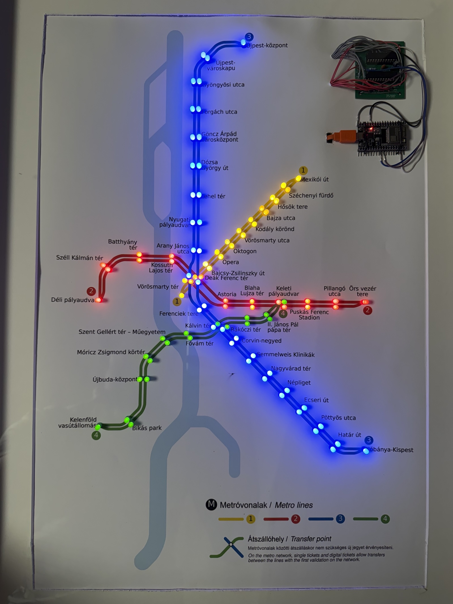
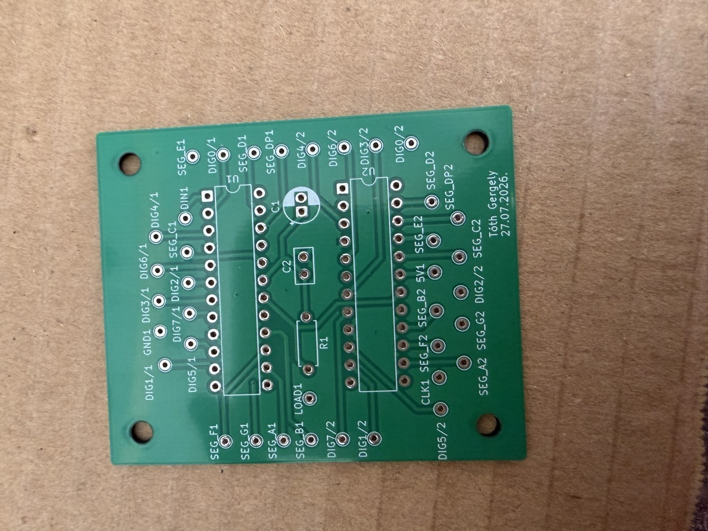
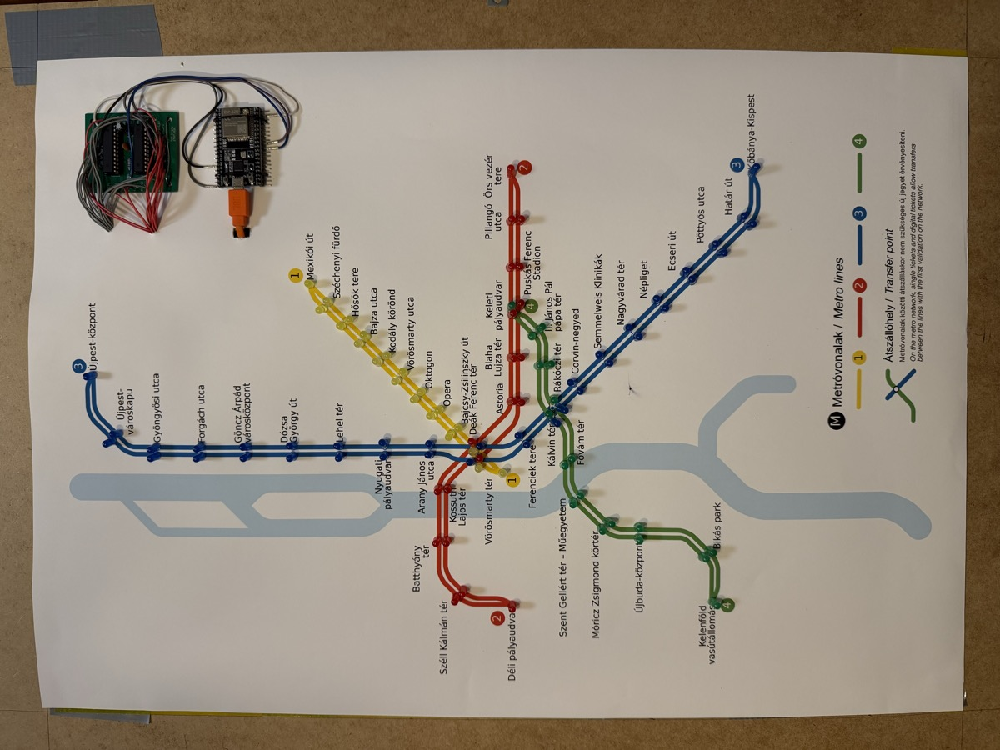
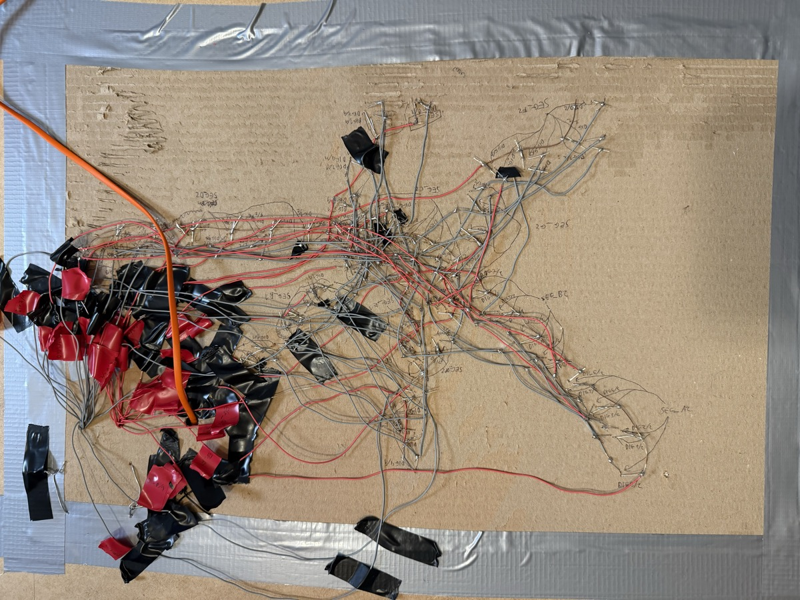

# Metromap

A map of the Budapest metro, designed to show trains moving on all four lines. There are 96 LEDs on the map: two at each station (one per direction) and one at each terminus. They are hand-wired and soldered onto the map and driven by an ESP32 through a custom PCB. Right now it runs a simulated train animation; live data from BKK is the next step.

I'd seen lit-up metro maps of other cities online, but none of Budapest, and I didn't like the design of the ones I found. Since I'm studying electrical engineering anyway, I decided to build my own.

## How it works

The LEDs are driven by two MAX7219 chips, controlled by an ESP32. Each chip has 16 outputs: 8 DIG (digit) pins that sink current and 8 SEG (segment) pins that source it. Each LED sits where one DIG line and one SEG line cross, so one chip can control 64 LEDs and the two together 128.

Only one DIG line is active at a time. The chip sets the SEG lines for the LEDs that should be lit in that row, pulls the DIG line low, then moves on to the next row. It cycles through all 8 rows hundreds of times a second, so every lit LED looks constantly on.

The two chips are daisy-chained: they share the ESP32's clock and load pins, and U1's data output feeds U2's data input. The ESP32 shifts out 32 bits, a 16-bit word for each chip (an 8-bit register address and 8 bits of data, which set the SEG lines for one DIG row), and then a pulse on LOAD makes both chips apply them at the same time.

There are 96 LEDs, so one chip wasn't enough. I split them by metro line, so each line stays on a single chip and both chips stay under the 64-LED limit:

| Chip | Lines | LEDs used | Spare slots |
|---|---|---|---|
| U1 | M1 + M2 | 40 | 24 |
| U2 | M3 + M4 | 56 | 8 |

Every LED has an ID (1–96) and is assigned a chip, a DIG and a SEG. This mapping table is in [station_map.h](firmware/metromap/station_map.h) (also as [a CSV](hardware/led-mapping.csv)).

The firmware builds on this table:

- **One LED by ID**: looks the ID up in the table and turns on that chip/DIG/SEG.
- **Walk test**: lights every LED in turn, 1 to 96, and prints its station to the Serial Monitor, so wiring mistakes are easy to spot.
- **Train mode**: each line gets a route, from one terminus out along the forward LEDs and back along the backward ones, and four trains, one per line, move one stop at a time.

## Hardware

I designed the driver PCB myself in KiCAD and had it made by NYÁKÁRUHÁZ Kft. It holds both MAX7219s in DIP sockets, so the soldering heat couldn't damage the chips. Every DIG and SEG pin goes to a labelled pad.

From each pad, a wire runs to the back of the map, where it connects to the right LEDs. That's around 150 solder joints in total, all by hand.

*The back of the map. Every wire is labelled in pencil with its DIG/SEG line.*

| Part | What |
|---|---|
| Microcontroller | ESP32-WROOM-32U dev board |
| LED drivers | 2 × MAX7219 (DIP-24, socketed) |
| PCB | Own design in KiCAD, made by NYÁKÁRUHÁZ Kft. |
| LEDs | 96, one colour per line |
| Map | Printed poster on cardboard |
| Power | 5 V from USB, via the ESP32 |

Design files: [schematic (PDF)](hardware/Metromap%20schematic.pdf) · [KiCAD project](hardware/kicad/) · [3D render](docs/images/pcb-3d.png)

### What I'd do differently

- **The wiring.** It works, but it's hard to trace and service. Next time I'd group the LEDs on small boards or connectors behind each line, with ribbon cable to the driver board.
- **The ISET resistor.** Both chips share one 10 kΩ R1, but each MAX7219 should have its own. According to the datasheet’s output current curves, a shared resistor behaves roughly like 20 kΩ per chip, about 25 mA peak per segment instead of about 45 mA, and the split between the chips isn’t guaranteed to be even. It works and the brightness looks fine, but a second version would give each chip its own resistor.

## Build and flash

Built with Arduino IDE 2.3.10 and the Espressif ESP32 board package 3.3.12.

1. Install the **MD_MAX72xx** library (by majicDesigns, tested with 3.5.1) from the Library Manager.
2. Open `firmware/metromap/metromap.ino`.
3. Select **Tools → Board → ESP32 Dev Module** and the ESP32's serial port.
4. Upload.

Pick the mode in `loop()`: `trainMode()` runs the train animation, and `walkTest()` lights every LED in turn and prints each station to the Serial Monitor (115200 baud).

## What went wrong and how I fixed it

For a long time the addressing didn't work: telling the firmware to light a specific DIG/SEG lit the wrong LED. I lit one address at a time and wrote down which LED actually came on, until a pattern appeared: the MD_MAX72xx library numbers the columns in a different order from the chip's SEG pins. SEG_A is column 6, down to SEG_G at column 0, and only SEG_DP stays at column 7. I then tested that theory LED by LED, and it held. The fix is a single line in [metromap.ino](firmware/metromap/metromap.ino).

More in the [bring-up log](docs/bring-up-log.md), including how the datasheet corrected my assumption about the shared ISET resistor.

## What's next

- **Live trains.** I chose the ESP32 for its built-in Wi-Fi. The plan is to fetch data from BKK's open API using an API key. As it turns out, BKK doesn't publish live positions for metro trains, only a timetable that's updated in real time, so the map has to work out where each train is from that.
- **Turning a timetable into train positions.** This is the tricky part. Using the timetable directly, a train could disappear between two stations, or appear at several at once. Each train has to be tracked so that it's always shown at exactly one station: the last station it departed from, until its scheduled departure from the next one.
